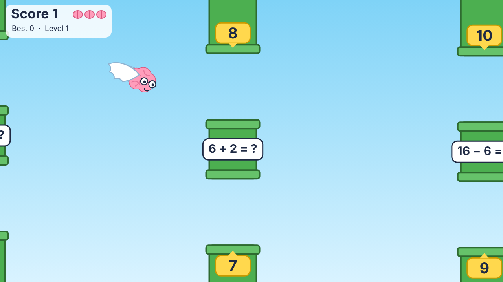

# Happy Nerds

Flappy Bird with a maths twist. You flap a **winged brain** through gates. Each gate shows **one question and two answers**, one beside each opening. Read the question, pick the right answer, and fly through that answer's opening.

This is the **mechanics prototype**. Everything is drawn with flat placeholder shapes in code. Real art goes in [`assets/`](assets/) once the design is ready.

Happy Nerds is a standalone project. It shares nothing with the Homeward Hound game in the repo root.



More previews: [tutorial](docs/previews/tutorial.png), [flap](docs/previews/flap.png), [wrong answer](docs/previews/wrong-answer.png), [phone](docs/previews/phone-tutorial.png).

## Play the latest build

Scan with your phone, or open https://claude.ai/artifact/FfBkJVJsA8hKCKUGRKwZtN. The link always shows the newest build. It's private, so sign in to claude.ai on the phone with the owner's account, or share the page from its Share menu.


## Run it

```bash
cd happy-nerds
npm install
npm run dev        # http://localhost:5173
npm test           # question + gameplay tests
npm run build      # typecheck + static build into happy-nerds/dist/
```

## How to play

| Action | Keyboard | Mouse | Touch |
|---|---|---|---|
| Flap up | Space, ↑ or W | Click anywhere | Tap anywhere |
| Start / try again | same | same | same |

- The brain keeps the same spot across the screen. Each flap pushes it up, and gravity pulls it down between flaps. Touching the top of the screen just stops the climb. Dropping to the bottom costs a brain and bounces you back up.
- Gates move toward you and never move up or down. Each gate has:
  - an **upper opening** with its answer on the wall just above it,
  - the **question** on the solid section between the openings,
  - a **lower opening** with its answer on the wall just below it.

  All three sit together, so you can compare both answers without looking back at the brain. The labels are on solid wall, never in the flight path.
- **Right opening:** +1 point. **Wrong opening:** lose a brain, and the game shows the right answer. **Hitting a solid part:** lose a brain. Each gate is judged only once.
- You have 3 brains. After losing one, you get a short blink of safety.
- Gates speed up slightly with every correct answer. Your best score is saved in the browser.
- The start screen is the tutorial. The first real gate waits on screen with its question and answers labelled, and the brain hovers until your first flap.

## Level 1: adding and taking away

- Answers are 1–12. Numbers in questions are 0–20, and subtraction never goes below zero.
- The wrong answer is always a near miss (±1 to 3), so you have to actually work it out.
- The right answer is randomly placed in the upper or lower opening.
- Levels are data (`MathLevel` in `src/questions.ts`). Longer questions wrap onto several lines on the gate.

## Collision and timing

| Setting | Value | Why |
|---|---|---|
| Brain hit circle | radius 23 px | Inside the 30 px body drawing. Wings and wing tips never collide. |
| Opening height | 170 px | More than 3× the hit circle, so there's room to be a bit off. |
| Question section | 150 px | Fits a wrapped question of up to 3 lines. |
| Gate speed | 170 → 250 px/s | At top speed, a gate still takes over 3.5 s from the right edge to the brain, enough time to read and steer. |
| Gate spacing | 640 px | Enough time to cross from one opening to the other between gates. |
| Flap / gravity | 430 px/s up, 1250 px/s² | Each tap gives a short, controllable hop. |

All tuning is in `src/config.ts`.

## Code map

| File | What it does |
|---|---|
| `src/config.ts` | All tuning: brain flight, gate layout, speed, lives |
| `src/questions.ts` | Question and near-miss answer generator, level definitions, seeded RNG |
| `src/game.ts` | Pure game state and fixed-step simulation (no DOM), so it's easy to test |
| `src/render.ts` | Canvas drawing: winged brain (flap animation, idle flutter, tilt), gates, tutorial, HUD |
| `src/main.ts` | Loop, keyboard/mouse/touch input, screen fit, best-score storage |
| `tests/` | Question correctness, flight and gate rules, judged-once checks, and a fairness check: an autopilot that flies like a careful player must keep scoring without losing a brain |

## Not built yet

The design brief mentions combo/XP rewards, categories, level progression, an IQ Meter, achievements and category completion bonuses. None of these exist in this prototype yet. Score and lives are the only progress so far.
